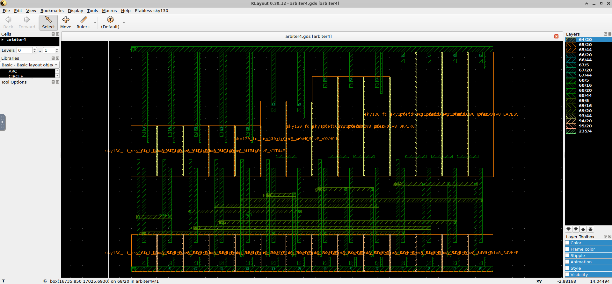
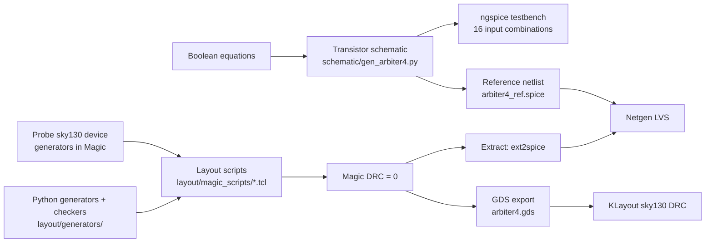
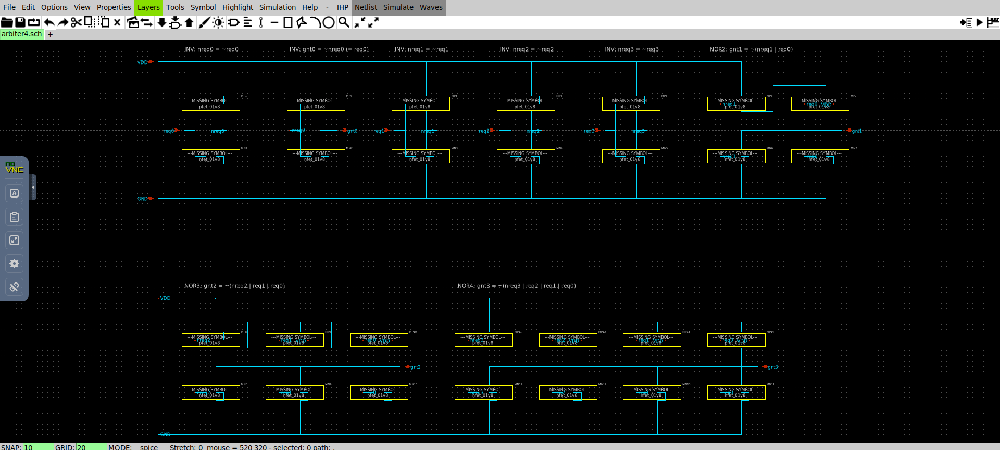
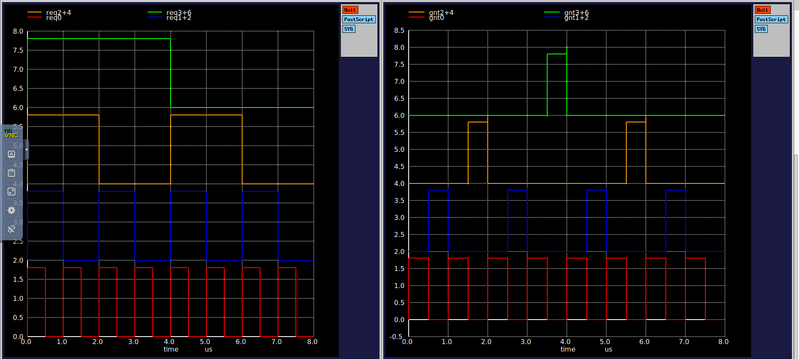
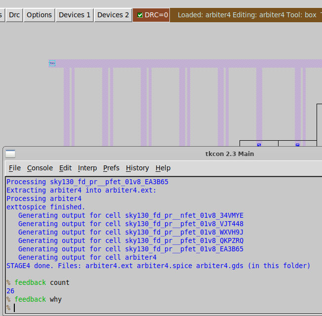
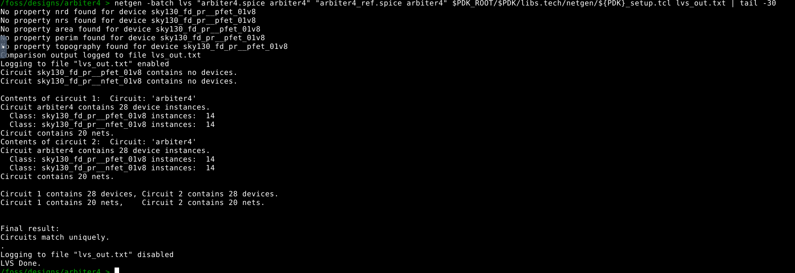
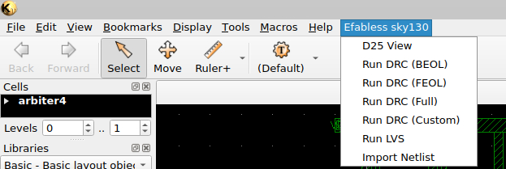
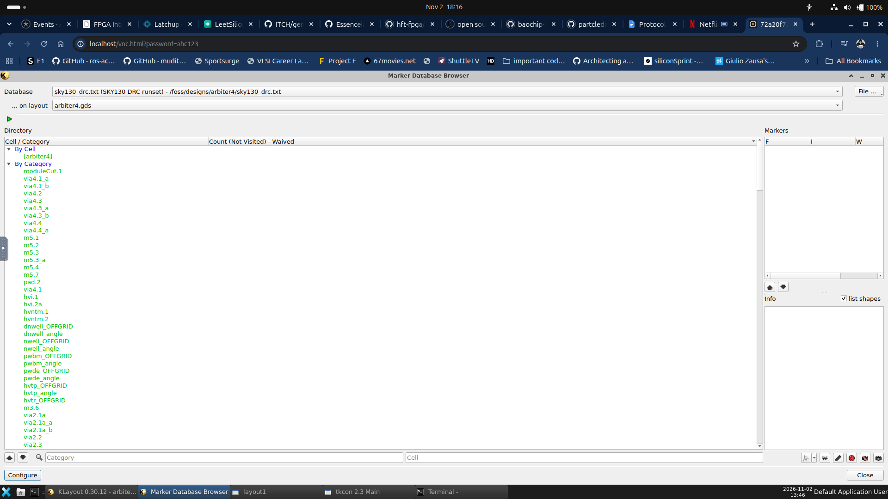
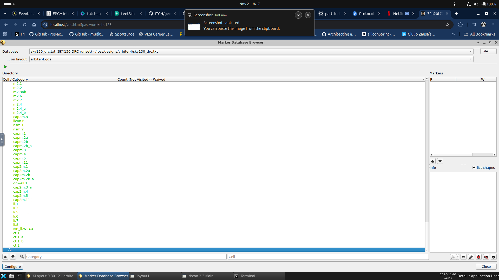

# 4-Request Fixed-Priority Arbiter — Full-Custom Layout in SkyWater sky130A

A complete **schematic → simulation → layout → DRC → LVS → GDS** flow for a 4-input fixed-priority
arbiter, built at transistor level (28 MOSFETs) with the open-source **IIC-OSIC-TOOLS** stack
(Xschem, ngspice, Magic, Netgen, KLayout) on the **SkyWater sky130A** PDK.

**Author:** Pennama Karthikeya · **Course / Institution:** Digital IC design,IIITDM Kurnool


*Final `arbiter4.gds` opened in KLayout: PMOS row on top, NMOS row at the bottom, ten metal2 buses in the channel between them.*

## Results at a glance

| Check | Tool | Result | Evidence |
|---|---|---|---|
| Layout design-rule check | Magic | **0 errors** | [screenshot](docs/images/04_magic_drc0_and_extraction.png) |
| Foundry-style DRC, "Full" runset (FEOL + BEOL) | KLayout, sky130 deck | **no markers** | [categories](docs/images/07_klayout_drc_full_categories.png), [empty marker list](docs/images/08_klayout_drc_no_markers.png) |
| Layout vs. schematic | Netgen | **Circuits match uniquely** (28 devices, 20 nets) | [screenshot](docs/images/06_netgen_lvs_match.png), [`results/lvs_out.txt`](results/lvs_out.txt) |
| Functional behaviour | ngspice | all 16 input combinations simulated | [waveforms](docs/images/ngspice_waveforms.png) |
| Final layout | — | [`layout/arbiter4.gds`](layout/arbiter4.gds) | ≈ 29.4 µm × 18.4 µm rail-to-rail (≈ 540 µm²) |

---

## 1. Specification

Four request lines `req0…req3` and four grant lines `gnt0…gnt3`. `req0` has the highest priority.
At most one grant is high at any time, and it belongs to the lowest-numbered active request:

```
gnt0 = req0
gnt1 = req1 & ~req0
gnt2 = req2 & ~req1 & ~req0
gnt3 = req3 & ~req2 & ~req1 & ~req0
```

Truth table (all 16 input combinations):

| req3 req2 req1 req0 | gnt3 gnt2 gnt1 gnt0 | | req3 req2 req1 req0 | gnt3 gnt2 gnt1 gnt0 |
|:-:|:-:|---|:-:|:-:|
| 0000 | 0000 | | 1000 | 1000 |
| 0001 | 0001 | | 1001 | 0001 |
| 0010 | 0010 | | 1010 | 0010 |
| 0011 | 0001 | | 1011 | 0001 |
| 0100 | 0100 | | 1100 | 0100 |
| 0101 | 0001 | | 1101 | 0001 |
| 0110 | 0010 | | 1110 | 0010 |
| 0111 | 0001 | | 1111 | 0001 |

The circuit is purely combinational (no clock, no state). A fixed-priority scheme can starve
low-priority requesters; a round-robin variant would need state and is listed under future work.

## 2. Circuit design

Each grant maps onto a CMOS NOR gate using `A & ~B = NOR(~A, B)`:

| Block | Function | Transistors | PMOS W (µm) | NMOS W (µm) |
|---|---|:-:|:-:|:-:|
| INV ×5 | `nreq0 = ~req0`, `gnt0 = ~nreq0`, `nreq1`, `nreq2`, `nreq3` | 10 | 2 | 1 |
| NOR2 | `gnt1 = ~(nreq1 \| req0)` | 4 | 4 | 1 |
| NOR3 | `gnt2 = ~(nreq2 \| req1 \| req0)` | 6 | 6 | 1 |
| NOR4 | `gnt3 = ~(nreq3 \| req2 \| req1 \| req0)` | 8 | 8 | 1 |
| **Total** | | **28** | | |

All devices use `L = 0.15 µm` (`sky130_fd_pr__nfet_01v8` / `pfet_01v8`). The series PMOS stacks of the
NOR gates are widened in proportion to stack height (4 / 6 / 8 µm) to keep their pull-up strength
comparable to the inverter.

`gnt0` is `req0` passed through two inverters (`nreq0` drives only the second one), which buffers the
highest-priority request.

## 3. Tools and environment

| | |
|---|---|
| Platform | IIC-OSIC-TOOLS Docker image (Xvnc desktop) |
| PDK | SkyWater **sky130A** (`sak-pdk sky130A`) |
| Schematic / simulation | Xschem, ngspice |
| Layout | Magic 8.3 (revision 685) with the sky130A tech file and its device generators |
| LVS | Netgen 1.5.324 with `sky130A_setup.tcl` |
| Independent DRC / viewing | KLayout 0.30.12 with the sky130 DRC deck |

## 4. Design flow



### 4.1 Schematic
[`schematic/gen_arbiter4.py`](schematic/gen_arbiter4.py) writes the Xschem schematic
`arbiter4.sch` (VDD/GND rails, series PMOS stacks, parallel NMOS, drawn wires inside each gate),
the plain SPICE netlist `arbiter4_ref.spice` and the testbench `tb_arbiter4.spice`.



[`verification/verify_sch.py`](verification/verify_sch.py) rebuilds the nets from the drawn wire geometry
of `arbiter4.sch` and checks that every transistor terminal lands on the intended net, with no shorts and no
dangling pins. [`verification/switch_level_check.py`](verification/switch_level_check.py) evaluates the
28-transistor netlist at switch level for all 16 inputs and compares it with the equations above.

### 4.2 Simulation
`tb_arbiter4.spice` drives the four requests with pulse trains of period 1, 2, 4 and 8 µs, so that the
8 µs run walks through all 16 combinations, with 10 fF on every grant output.

```bash
cd schematic && ngspice tb_arbiter4.spice
```



### 4.3 Layout
The layout is **built by scripts**: Magic's own sky130 device generators (`magic::gencell`) place the
transistors, and Tcl `paint` commands add the wiring. The geometry is computed by a Python generator
([`layout/generators/gen_all.py`](layout/generators/gen_all.py)) that also checks the result before
it is ever loaded into Magic (net connectivity, shorts, metal spacing, via enclosure, and a comparison of
the 28 transistors against the reference netlist). This makes the layout reproducible and parametric.
It was not drawn polygon-by-polygon with the mouse.

**Floorplan** — 14 columns on a 2.11 µm pitch, one PMOS above one NMOS per column:

```
 VDD rail (metal1) ─────────────────────────────────────────────────────────────
   |  guard-ring contacts and PMOS source straps run up to the rail
 PMOS row   P  P  P  P  P | P  P | P  P  P | P  P  P  P      widths 2 | 4 | 6 | 8 µm
   |        INV x5          NOR2    NOR3        NOR4
 ── channel ── 10 metal2 buses (req0-2, nreq0-3, gnt1-3) over vertical metal1 gate ties ──
 NMOS row   N  N  N  N  N | N  N | N  N  N | N  N  N  N      all W = 1 µm
   |  sources to GND rail
 GND rail (metal1) ─────────────────────────────────────────────────────────────
```

| Column | Gate net | PMOS W (µm) | Role |
|:-:|---|:-:|---|
| 1 | req0 | 2 | inverter → `nreq0` |
| 2 | nreq0 | 2 | inverter → `gnt0` |
| 3 | req1 | 2 | inverter → `nreq1` |
| 4 | req2 | 2 | inverter → `nreq2` |
| 5 | req3 | 2 | inverter → `nreq3` |
| 6–7 | req0, nreq1 | 4 | NOR2 (output end on the left, VDD end on the right) |
| 8–10 | req0, req1, nreq2 | 6 | NOR3 |
| 11–14 | req0, req1, req2, nreq3 | 8 | NOR4 |

Key layout decisions:

* **Device generators and guard rings.** Every generated transistor carries its own guard ring tied to
  its bulk, so no separate tap rows are needed. Each PMOS well is 2.11 µm wide, which equals the column
  pitch, so neighbouring wells abut and avoid well-to-well spacing violations.
* **Gate ties.** The PMOS and NMOS gates of one column are joined by a vertical metal1 strap.
* **Supply rails.** A GND rail below the NMOS row and a VDD rail above the PMOS row. Every guard ring is
  contacted (local-interconnect-to-metal1 contact) and strapped to its rail.
* **Cross-column signals** run on ten horizontal metal2 tracks (0.45 µm pitch) in the channel between the
  rows, connected down with 26 `via1` contacts. The three series PMOS stacks use short metal1 straps between
  neighbouring columns.
* **Stack order.** Inside each NOR gate the PMOS devices are ordered right-to-left from the VDD end, so
  every series link joins the right pad of one transistor to the left pad of its neighbour. Source and drain of a
  MOSFET are interchangeable, which LVS accounts for.
* **Pins.** Ten ports (`req0–3`, `gnt0–3`, `VDD`, `GND`) are labelled on the metal2 buses, metal1 gate ties,
  and supply rails.

To rebuild the layout (inside the container, in the `layout/` directory):

```bash
sak-pdk sky130A
magic -rcfile $PDK_ROOT/$PDK/libs.tech/magic/sky130A.magicrc &   # click the layout window, then in tkcon:
source magic_scripts/build_arbiter4.tcl      # place 28 transistors, tie gates
source magic_scripts/stage2_rails.tcl        # VDD/GND rails, ring contacts, source wiring
source magic_scripts/stage3_signals.tcl      # signal routing (metal1/metal2/via1)
source magic_scripts/stage4_labels_lvs_gds.tcl   # pin labels, DRC, extraction, GDS
```

The `stage2`, `stage3` and `stage4` scripts are generated by `layout/generators/` (`python3 gen_all.py`,
`python3 gen4.py`, which write into `magic_scripts/`); the Tcl files are committed so the flow can be reproduced
without running Python.

### 4.4 Verification

**Magic DRC — 0 errors; extraction and GDS export completed**



**Netgen LVS — layout matches the reference netlist (28 devices, 20 nets)**



The layout was extracted with `extract all; ext2spice lvs; ext2spice` and compared to
`schematic/arbiter4_ref.spice`, the same netlist that was simulated in ngspice. Netgen reports `Circuits match uniquely.`
The "No property … found" lines are notes about optional device properties, not errors.

**KLayout DRC (sky130 "Full" runset: FEOL + BEOL)**





The marker browser lists every rule of the deck. With `All` selected the marker list is empty, i.e. no violations.

## 5. Development log — problems found and fixed

| # | Symptom | Cause | Fix |
|:-:|---|---|---|
| 1 | `tech minimum`; `No import routine for sky130 library cell` | Magic started with a wrong `-rcfile` path, so the sky130A tech was never loaded | Use `sky130A.magicrc` (successful [device-generator probe](docs/images/01_device_generator_probe.png) after the fix) |
| 2 | `Box tool must be present` | Console commands issued without a layout window selected | Run in the Magic GUI and create the box first |
| 3 | 84 DRC error tiles: `Metal1 minimum area < 0.083 (met1.6)` ([first placement](docs/images/02_first_placement_before_fixes.png), [message](docs/images/03_drc_min_area_message.png)) | The unused gate-contact pad at the far end of each generated transistor is 0.067 µm² | Enlarge those 28 pads |
| 4 | `invalid command name ".params.title.ient"` on re-run | `gencell` treats an existing instance name as an edit | Scripts now refuse to run on a cell that already has devices |
| 5 | `Via1 width < 52 (via.1a + 2*via.4a)` | `via1` tile painted at 0.15 µm; Magic needs 0.26 µm (cut plus enclosure) | Paint `via1` at 0.26 µm |
| 6 | `Metal1 overlap of Via1 < 6 in one direction (via.5a - via.4a)` ([message](docs/images/03b_via1_overlap_error.png)) | Metal ended flush with the via tile | Extend metal ≥ 0.03 µm past every via on both layers; the Python checker now tests this rule |
| 7 | LVS "setup file does not exist" / `netgen: command not found` | Typo in the setup file path; `docker exec` shell lacks the tool PATH | Use the full path to `sky130A_setup.tcl` and run in the desktop terminal |

## 6. Repository structure

```
schematic/              gen_arbiter4.py, arbiter4.sch, arbiter4_ref.spice, tb_arbiter4.spice
layout/
  arbiter4.gds          final layout (GDSII)
  arbiter4.mag          Magic source (+ generated transistor cells *.mag)
  magic_scripts/        probe_devices.tcl, build_arbiter4.tcl, stage2…4 Tcl scripts
  generators/           gen_all.py, gen4.py (script generators + checks), topo.py
verification/           verify_sch.py, switch_level_check.py
results/                lvs_out.txt, arbiter4_extracted.spice, KLayout DRC report
docs/images/            screenshots used in this README
scripts/collect_outputs.sh   copies tool outputs from the container folder into the repo
```

Run the Python checks (no EDA tools needed, Python 3 only):

```bash
cd schematic && python3 ../verification/verify_sch.py && python3 ../verification/switch_level_check.py
cd ../layout/generators && python3 gen_all.py && python3 topo.py
```

## 7. Limitations and future work

* **No post-layout timing.** The simulation was run on the schematic netlist; parasitics were not extracted,
  so propagation delay (especially of the 4-high series PMOS stack in `gnt3`) has not been measured.
* **Not tape-out ready.** No I/O pads, density fill or antenna analysis; the sky130 "Full" runset passed,
  but metal-density and antenna checks were not part of this run.
* **Fixed priority only.** A round-robin arbiter (a "last granted" register plus rotating priority) removes
  starvation and is a natural extension.
* **Sizing was chosen by rule of thumb** (stack-proportional PMOS widths), not optimised for delay or area.

## 8. Acknowledgements

* IIC-OSIC-TOOLS (JKU Linz) for the container image; SkyWater sky130 PDK; Magic, Netgen, KLayout, Xschem and ngspice.
* The schematic/layout generator scripts and this documentation were developed with AI assistance
  (Claude); all results shown were produced and checked by running the tools listed above.

## License

MIT — see [LICENSE](LICENSE).
